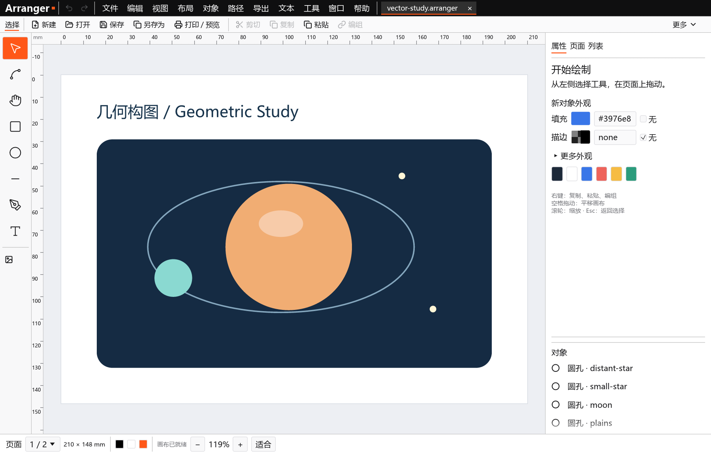
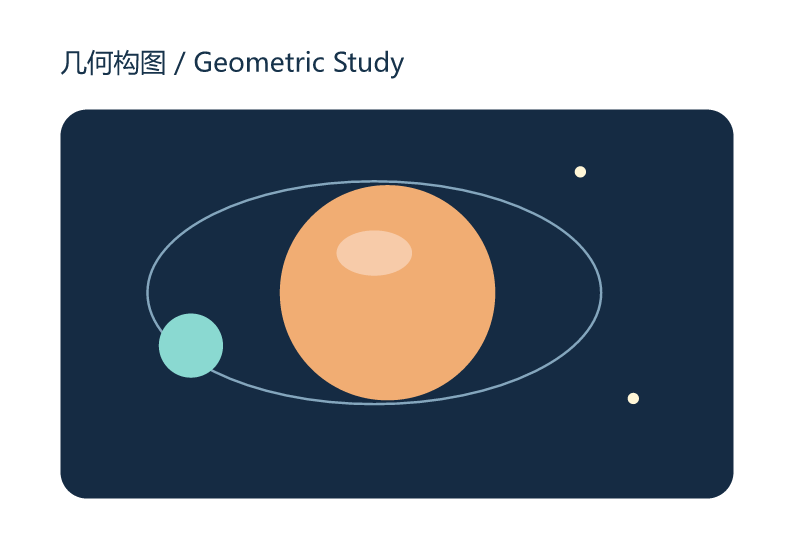
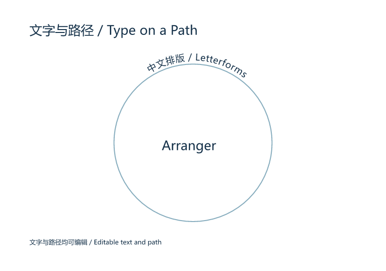
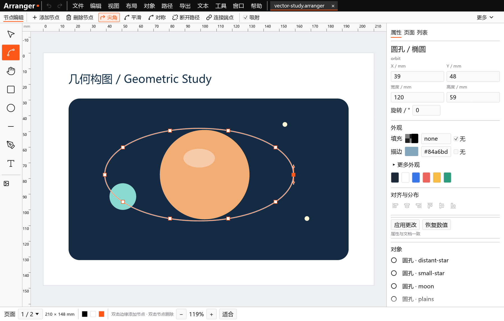
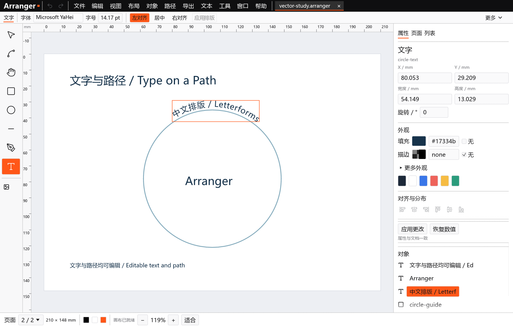

<h1 align="center">Arranger</h1>

<p align="center"><strong>用毫米绘图，为多页文档排版。</strong></p>

<p align="center">
  <a href="https://github.com/loaye1203/Arranger/releases/download/v0.1.0-preview.1/Arranger-v0.1.0-preview.1-windows-x64.zip"><strong>下载 Windows x64 便携版</strong></a>
  · <a href="https://github.com/loaye1203/Arranger/releases/tag/v0.1.0-preview.1">发行说明与校验文件</a>
  · <a href="#从源码构建">从源码构建</a>
</p>

<p align="center">
  <a href="docs/images/arranger-workspace.png"></a>
</p>

Arranger 是一款开源、本地运行的二维矢量编辑器。你可以直接在画布上绘制和排版，也可以在属性面板里按毫米输入位置与尺寸。每一页都有自己的尺寸，同一份文档可以同时包含图形、文字和图片。它适合制作需要按实际尺寸绘制的矢量图、图文版面和多页文档。

编辑中的文件保存为 `.arranger`。需要交付时，可以导出 PDF、SVG、PNG，或在兼容范围内与 CorelDRAW 交换 CDR 14 / 21 文件。

## 图形、节点和文字

<table>
  <tr>
    <td width="50%">
      <a href="docs/images/geometry-study.png"></a><br>
      <strong>几何构图</strong><br>
      用矩形、椭圆、填色和描边组合出一页矢量图形。
    </td>
    <td width="50%">
      <a href="docs/images/typography-study.png"></a><br>
      <strong>文字沿路径</strong><br>
      同一行可以混排中英文，文字和导向路径都保留为可编辑对象。
    </td>
  </tr>
  <tr>
    <td width="50%">
      <a href="docs/images/edit-path-nodes.png"></a><br>
      <strong>节点与精确尺寸</strong><br>
      在画布上调整曲线节点和切线，或直接输入对象的位置、宽高与旋转。
    </td>
    <td width="50%">
      <a href="docs/images/edit-path-text.png"></a><br>
      <strong>在版面里改字</strong><br>
      在画布上编辑文字，使用工具栏调整字体、字号和对齐方式。
    </td>
  </tr>
</table>

除了绘图和文字，Arranger 也支持图片裁剪，以及对象编组、对齐与分布。上面的两页来自 Windows 便携包附带的 `samples/vector-study.arranger`。打开它，可以试着移动轨道、修改行星填色，或者编辑圆弧上的文字。

## 保存原稿，按用途交付

- **.arranger 原稿**保留页面、对象、文字和资源，适合日常编辑和后续修改。
- **PDF**可以输出全部页面、当前页或指定页码范围，每页保留原有的毫米尺寸。
- **SVG 和 PNG**分别用于交换矢量图形和输出位图。
- **CDR 14 / 21**用于兼容范围内的 CorelDRAW 文件交换。保编辑导出保留可表示的对象结构和活文字，文字排版仍取决于接收端的字体与排版行为。保外观副本会把文字转为曲线。导出前会检查所选版本能否表示文档内容。

<p align="center">
  <a href="docs/images/multipage-pdf-export.png"></a>
</p>

## 快速上手

1. 下载并完整解压 Windows x64 便携包，打开其中的 `Arranger` 文件夹，双击 `START-ARRANGER.cmd`。
2. 在「文件 → 打开」中选择 `samples/vector-study.arranger`，用底部的页码控件在两页之间切换。
3. 修改一个对象，把自己的版本另存为 `.arranger`，再通过「导出 → PDF」输出两页。样稿目录附有对应的参考 PDF。

当前发布的是 Windows x64 预览版，程序未签名。Apple Silicon 的构建与打包脚本随源码提供，macOS 安装镜像待实机验收。

## 从源码构建

Arranger 使用 Rust，桌面编辑器和命令行工具共享编辑与导出内核。命令行可通过 JSONL 请求创建文档、批量编辑对象或导出文件。仓库里的 [双页示例生成器](https://github.com/loaye1203/Arranger/blob/main/examples/v1_design.py) 使用同一套接口。

构建需要 Rust 1.99 或更新版本。Windows x64 需要 MSVC C++ Build Tools 和 Windows SDK，Apple Silicon macOS 需要 Xcode Command Line Tools。首次构建会获取锁定的依赖与 Skia 构建所需的库。

```sh
cargo build --workspace --release --locked
cargo run --locked -p arranger -- gui
cargo run --locked -p arranger -- describe
```

只构建命令行版可运行 `cargo build --release --locked -p arranger --no-default-features`。首次运行测试前在仓库根目录创建 `artifacts`，再执行 `cargo test --workspace --locked`。部分文字测试需要测试名称指定的系统字体。

[命令协议](https://github.com/loaye1203/Arranger/blob/main/docs/API.md) · [JSON Schema](https://github.com/loaye1203/Arranger/blob/main/docs/api-v1.schema.json) · [测试样本说明](https://github.com/loaye1203/Arranger/blob/main/docs/TEST_FIXTURES.md) · [问题反馈](https://github.com/loaye1203/Arranger/issues)

## 许可证

项目自有源码采用 [MIT 许可证](https://github.com/loaye1203/Arranger/blob/main/LICENSE)。第三方组件、图标和内置界面字体的许可见 [NOTICE](https://github.com/loaye1203/Arranger/blob/main/NOTICE) 与 [第三方许可目录](https://github.com/loaye1203/Arranger/tree/main/docs/third-party-licenses)。

